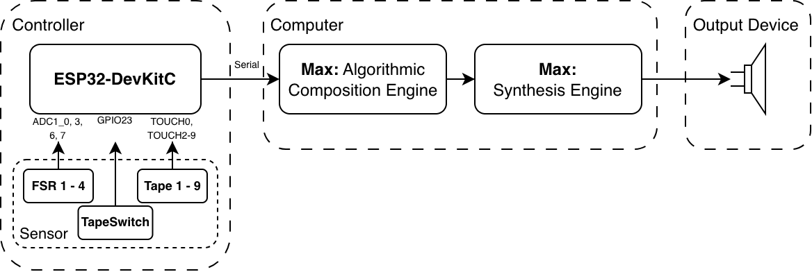

# Remembear: A Plushie That Remembers Touch

## Project Description

Remembear is a plushie instrument that remembers the user's touch. When the user touches or squeezes different parts of the plushie's body, Remembear remembers the input and uses it to compose a song in real time, with a clear musical structure and aesthetic. The user will feel as if Remembear is collaboratively composing with them, since their motif input will appear in the composition both in its original and transformed form.

Here is the [link to a demonstration video](https://drive.google.com/file/d/1MXOZC_ItX4dhNBUSW9rlTSylKNMK16Rh/view?usp=drive_link) playing the *Remembear Theme* composition.

## Goals

1. Digital musical instruments often fail to form a personal relationship with the user. Remembear aims to present a DMI design that encourages an emotional bond with the user through a soft, friendly interface, touch-based gestures, and a collaborative composition process in which the instrument transforms the player's own touch input.
2. Remembear aims to present an approach that makes musical composition easy and playful for anyone through a plushie interface, an algorithmic composition engine built on step sequencing, and a synthesis engine modeled on the voice structure of early NES 8-bit music.

## Implementation

### System Architecture

Remembear consists of three types of sensors: FSR, capacitive touch, and switch. There are four FSR sensors, located in the left and right arms and the left and right ears. The nine touch sensors are located on the plushie's T-shirt. The switch is custom-made from two pieces of conductive fabric tape, the same material used for the touch sensors. The pieces are placed on the tips of the plushie's left and right ears, and the switch is triggered when they come into contact with each other.

When the ESP32 receives data from the sensors, the Arduino sketch sends it to the Max patch via USB serial. The Max patch consists of two parts: the algorithmic composition engine and the synthesis engine. The algorithmic composition engine maps the data to different parameters, applies input transformations, and creates the musical structure. The synthesis engine consists of four layers: melody, harmony, bass, and drums. This layer design and the sonic character of the synthesis engine are based on the structure of early NES 8-bit game music, drawing on the playful memories people already associate with it.

### Mapping

The nine capacitive touch tapes (T0, T2–T9) send scale degrees (1-8) and a rest (0). In the Max patch, `p degreeToNote` object converts the degrees to MIDI notes.

| Sensor | Degree | Note (key of C) |
|---|---|---|
| Touch T0 (GPIO 4) | 1 | C4 |
| Touch T2 (GPIO 2) | 2 | D4 |
| Touch T3 (GPIO 15) | 3 | E4 |
| Touch T4 (GPIO 13) | 4 | F4 |
| Touch T5 (GPIO 12) | 5 | G4 |
| Touch T6 (GPIO 14) | 6 | A4 |
| Touch T7 (GPIO 27) | 7 | B4 |
| Touch T8 (GPIO 33) | 8 | C5 |
| Touch T9 (GPIO 32) | 0 | Rest |

The four FSRs are mapped to continuous controls of effect parameters.

| Sensor | Location | Parameter |
|---|---|---|
| FSR A0 (GPIO 36) | \*Left arm | Filter cutoff |
| FSR A3 (GPIO 39) | Right arm | Note division |
| FSR A6 (GPIO 34) | Left leg | Reverb mix |
| FSR A7 (GPIO 35) | Right leg | Bitcrush mix |

\* *Left/right is from the user's perspective, facing the plushie; not from the plushie's perspective.*

The ear switch sends a bang to `counter 1 7`. Each count is mapped to a different function through `sel`.

| `sel` | Function |
|---|---|
| 1 | Harmony layer on |
| 2 | Bass mode |
| 3 | Drums on |
| 4 | Section B (key of F, half time, motif retrograde) |
| 5 | Section C (key of C, original tempo, motif shuffled) |
| 6 | Return to Section A (key of C, original tempo, original motif) |
| 7 | Stop and reset |

### Input Transformations

The melodic motif entered by the user through the touch tapes is transformed by Remembear's algorithmic composition engine using four motif transformation techniques: tonal sequencing, augmentation, retrograde, and permutation. Tonal sequencing occurs randomly, with a chance that increases as the total loop count grows. Augmentation is applied when the music transitions into Section B on the 4th ear switch press. Retrograde is also applied during Section B by iterating through the notes stored in the `coll` object in reverse order. Permutation occurs during Section C, which is triggered by the 5th ear switch press. It is implemented by randomly shuffling the order of the notes stored in `coll`.

Beyond melodic transformations, the algorithmic composition engine also implements global transformations. These include key changes, tempo changes, and changes to the effect parameters' default values.

## Result

Remembear consistently composes a song with a clear musical structure and aesthetic from any motif input. This is achieved through the step sequencer design, the musical arc created by adding layers over time, and the distinct musical sections. This indicates that one of the instrument's goals has been achieved, which is to make musical composition easy and playful for anyone.

## Limitations

1. The touch sensors are very sensitive and are easily triggered by the slightest touch.
2. The control bandwidth is narrow since squeezing is a whole-hand gesture. This only allows about two simultaneous pressure controls.
3. The FSRs in the ears are very sensitive and produce jittery control.
4. There is a bug within the Max patch where the synthesizer of the harmony layer sometimes keeps sustaining after everything is reset.
5. There is no separate reset control for the melody and bass layers. There is only one global reset, triggered by the last ear switch press.
6. The musical range is narrow since the key, drum sample, and synthesizer voices are fixed.
